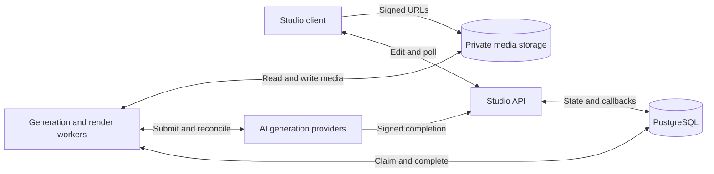

# Briqen Creator Studio assignment plan

Design the backend for a marketer turning a research insight into a two-scene reel. The case to prove is a video generation that times out after the marketer has already approved an image. The marketer should recover the video, understand the credit charge, keep editing, and export the cut they approved. [Briqen product and role research](RESEARCH.md)

The take-home allows **45 minutes** and **up to two pages**. Submit a small architecture sketch, one project trace, 10–20 lines of retry and late-result pseudocode, and the first-release decisions. The required AI disclosure goes in a separate appendix. A relevant prior-work link is optional.

## Architecture to sketch

Use one application API, PostgreSQL, private object storage, and workers for AI generation and rendering. PostgreSQL stores both workflow state and the durable jobs that workers claim. Creating a job and reserving credits in one commit makes a successful API response durable. A worker claims due rows with `FOR UPDATE SKIP LOCKED`, records an expiring lease, and commits before calling a provider. A reclaimed job resumes using its persisted request key. Worker updates check the lease and expected job state so a slow worker cannot undo a completed callback. [PostgreSQL locking documentation](https://www.postgresql.org/docs/current/sql-select.html#SQL-FOR-UPDATE-SHARE)



| Record | What it preserves |
| --- | --- |
| `Project` | Workspace owner, campaign brief, current script revision, timeline version. |
| `ScriptRevision` | Immutable text, parent revision, project and author. Saving an edit creates a revision. |
| `Scene` | Stable ID, source script revision, visual input version, position, trim start, duration, accepted asset, current candidate and latest generation job. Reordering or trimming leaves its visual input version intact. |
| `Asset` | Immutable media ID and storage key, type, duration where applicable, and producing job. A generated candidate becomes part of the cut only through explicit acceptance. |
| `Job` | Kind, workspace and target, immutable inputs, client action key, state, lease and next check, provider request key and run ID when known, expiry, result or error. Types cover script assistance, media generation, and export. |
| `CreditReservation` | One row per billable generation job, keyed by `job_id`, with quoted amount and held, captured, or released status. |

An authorized `POST /scenes/{id}/generations` returns **`202 Accepted`** with `jobId`, `state`, and a `Location: /jobs/{id}` header as soon as the transaction commits. The client polls this URL and restores job and approved-media state on reload. The status response returns a candidate asset ID on success, a `confirming` state during an uncertain timeout, or an actionable terminal error. Export uses the same asynchronous contract. Scope project and status reads to the workspace and issue short-lived media URLs after the same access check. [HTTP 202 semantics](https://www.rfc-editor.org/rfc/rfc9110.html#name-202-accepted)

## Trace a two-scene cold brew reel

1. A marketer brings a creative insight about motion in the opening seconds. A script worker uses that brief to draft a cold brew reel and saves it as revision `r1`. The marketer edits the call to action and the API saves `r2`. Splitting `r2` creates `S1`, a product still, and `S2`, a pour video.
2. The marketer requests one image and one video. The generation worker sends each provider the job’s saved input snapshot and stable request key. `S1` completes and the worker stages image `A1` in private storage. The marketer accepts `A1`. `S2` exceeds its waiting threshold and the editor shows **Checking video generation** with a **Retry status** action. The timeline stays editable.
3. Retry returns the existing `S2` job and expedites reconciliation. The original callback arrives late. While its job is current and within its recovery window, the worker verifies the run, saves clip `V1`, and atomically marks the job successful, captures its held credits, and publishes `V1` as a candidate. `A1` stays accepted. The marketer previews and accepts `V1`.
4. The marketer deliberately requests another pour variant. **Regenerate** displays its new credit quote and, after confirmation, creates a new job and hold. Its result appears as candidate `V2` while `V1` stays accepted. The marketer keeps `V1`. If they later choose `V2`, acceptance compares the selected candidate ID with the current candidate before changing the cut.
5. The marketer moves `S2` first, trims a six-second segment from `V1`, and sets the `S1` still to four seconds. The API validates the accepted assets and writes the ordered asset IDs, trim offsets, durations, and render preset into a job in one transaction. The render worker reads those exact objects, produces a ten-second vertical MP4, and returns a signed download through job status. Changes made after export starts apply to a later export.

## Retry, regeneration, and one credit charge

Create the job and atomically hold its quoted credits against the workspace balance. `UNIQUE(workspace_id, client_action_key)` on `Job` collapses repeats of the same paid action. The client retains the key until it knows the job ID. Return the existing job for the same key and payload. Reject a key reused with different inputs. `CreditReservation.job_id` is the primary key. In the completion transaction, a conditional `held → captured` update and the balance change take effect together with result publication. A hold reduces available credits immediately. Capture converts the same hold to a posted charge. Terminal failure or expiry releases the hold in a transaction. This proposal charges for a generated candidate the marketer receives, regardless of their later acceptance decision.

A timeout moves the job to `confirming`. Retry on that job wakes a status check with the same provider request key. If lookup cannot find the submission, replay is allowed only within the provider’s idempotency window and with the identical key and payload. Retry clicks share the existing hold. A definitive failure or expiry ends that action with the hold released. A new paid generation then requires explicit confirmation. Regenerate deliberately starts a distinct action with a distinct key. Keep one active media job per scene in v1. While it runs, the marketer can revise script drafts and adjust timeline order and timing. Applying a change to that scene’s visual inputs can wait for its current job to resolve.

Authenticated provider callbacks acknowledge delivery after durably recording the completion reference and making the job due for processing. A scheduled provider status check can recover missed callbacks. The worker verifies run identity and stages the file under an immutable key before publishing it. A result is eligible only when the job owns the scene’s current generation slot, the visual inputs still match, and the recovery window is open. Duplicate notifications, superseded jobs, and expired results cannot change the timeline or capture credits. Unreferenced staged objects can expire after a grace period. Operations on the same project acquire locks in a consistent order, starting with the project for scene and timeline writes. An unchanged accepted asset stays available for export while its replacement is in progress.

```text
retry(scene_id, job_id):
  transaction:
    scene, job = lock_project_scene_job(scene_id, job_id)
    require_access_and_matching_scene(scene, job)
    if is_current(scene, job) and job.state == CONFIRMING and before_deadline(job):
      job.next_check_at = earlier(job.next_check_at, db_clock())
    return job.status_view()

on_media_ready(event):
  job_id, scene_id, object_key = verify_run_and_stage(event)
  transaction:
    scene, job = lock_project_scene_job(scene_id, job_id)
    if job.state not in [RUNNING, CONFIRMING] or not before_deadline(job): return
    if not is_current(scene, job): return
    asset = insert_asset_once(job.id, object_key)
    capture_held_credits_once(job.id)
    job.succeed(asset.id)
    scene.candidate_asset_id = asset.id
```

`is_current` compares the latest job ID and visual input version. `insert_asset_once` uses a unique producing job ID for a single-result media job. The retry and callback paths never write the accepted asset pointer. The expiry transition uses the same locks as completion, and the completion handler checks the deadline after acquiring those locks.

**Design-changing assumption.** The media provider supports lookup by a client-chosen correlation key and deduplicates repeated submits with that key through the recovery window. That contract protects provider spend. PostgreSQL separately protects customer credits. If the provider cannot offer durable idempotency or lookup, use a known run ID or await its correlated callback, expose the uncertainty, and disable automatic resubmission for ambiguous outcomes. A local ledger cannot establish whether an unconfirmed provider request ran or was billed.

## First release and launch checks

**Build first.** Prove script revision → two scenes → accepted media → a single vertical MP4 using deterministic provider fixtures. Implement one generation and approval flow for both image and short video, lease recovery, quoted credits, and export from an immutable manifest. Swap in one provider integration per modality and keep the same tests at the adapter boundary. Use per-scene job status and keep the current cut editable while generation runs.

**Defer.** Live collaboration, a multi-track editor, provider failover, and automated ingestion of creator research. Those features can follow once reviewers can reconcile credits and explain exactly which assets appear in an export.

Run two checks before shipping.

1. **Generation recovery and credit integrity.** Use a fake provider to accept a request just before the worker loses its connection. Kill and restart the worker, double-click Retry, and deliver the original success through both callback and status polling. Assert one provider run, one result, one captured charge for the video action, and the original accepted image. Replay the old callback after a new paid regeneration and confirm it cannot replace the new candidate or charge again. Withhold success through expiry in another run and assert the hold is released and an expired callback is ignored.
2. **Export integrity during edits.** Accept `A1` and `V1`, move the video first, set six and four seconds, and start export. While rendering, change the timeline and approve a different video. Assert the first MP4 uses the original snapshot, has the expected manifest asset IDs and order, and plays for ten seconds within a frame. Verify a new export uses the updated choices.

For a pilot, log job and provider run IDs with state transitions, lease recovery, and credit outcomes. Track time from script to downloadable cut and the share of video timeouts recovered. Investigate a provider run with no matching job or an open hold past expiry before broadening the rollout.

## Finish the take-home in 45 minutes

| Time | Work to complete |
| --- | --- |
| 0–7 min | Write the two-scene story, settle the result-selection rule, and sketch the six components. |
| 7–19 min | Draft page 1 with the diagram, records, `202` response, and the end-to-end project. |
| 19–33 min | Draft page 2 with the timeout sequence, retry and regeneration rules, credit constraints, and 10–20 lines of pseudocode. |
| 33–39 min | Add the first-release scope, two checks, and one provider assumption. Walk through the late callback arriving before Retry, after Retry, twice, and after expiry. |
| 39–45 min | Verify the rendered two-page design, label the winning result and charge, confirm any prior-work claim, and attach the AI disclosure. |

**Submission.** Page 1 should show how one marketer gets a cut. Page 2 should make the late-result choice and charge traceable from the pseudocode. Include the optional project sample only with a specific contribution you can explain. If you rely on this plan, append the task-related prompt and relevant response excerpts, or a share link, with a short statement of what you changed and personally verified. Redact sensitive details and omit unrelated chat. The appendix sits outside the two-page cap.
