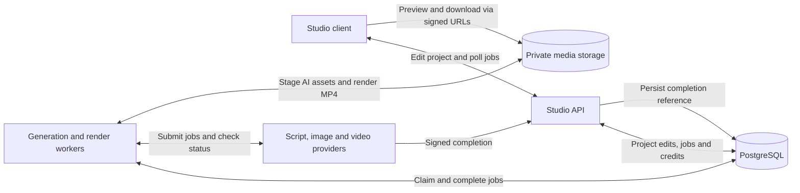

# Briqen Creator Studio assignment plan

Design the backend for a marketer turning a research insight into a two-scene reel. The case to prove is a video generation that times out after the marketer has already approved an image. The marketer should recover the video, understand the credit charge, keep editing, and export the cut they approved. [Briqen product and role research](RESEARCH.md)

The take-home allows **45 minutes** and **up to two pages**. Submit a small architecture sketch, one project trace, 10–20 lines of retry and late-result pseudocode, and the first-release decisions. The required AI disclosure goes in a separate appendix. A relevant prior-work link is optional.

## Architecture to sketch

Use one application API, PostgreSQL, private object storage, and workers for AI generation and rendering. PostgreSQL stores both workflow state and the durable jobs that workers claim. Creating a job and reserving credits in one commit makes a successful API response durable. A worker claims due rows with `FOR UPDATE SKIP LOCKED`, records an expiring lease, and commits before calling a provider. A reclaimed job resumes using its persisted request key. Worker updates check the lease and expected job state so a slow worker cannot undo a completed callback. [PostgreSQL locking documentation](https://www.postgresql.org/docs/current/sql-select.html#SQL-FOR-UPDATE-SHARE)



| Record | What it preserves |
| --- | --- |
| `Project` | Workspace owner, campaign brief, current script revision, timeline version. |
| `ScriptRevision` | Immutable text, parent revision, project and author. Saving an edit creates a revision. |
| `Scene` | Stable ID, source script revision, visual input version, position, trim start, duration, accepted asset, current candidate and latest generation job. Reordering or trimming leaves its visual input version intact. |
| `Asset` | Immutable media ID and storage key, type, duration where applicable, and producing job. A generated candidate becomes part of the cut only through explicit acceptance. |
| `Job` | Kind, workspace and target, immutable inputs, client action key, state, lease and next check, provider request key and run ID when known, expiry, result or error. Types cover script assistance, media generation, and export. |
| `CreditReservation` | One row per billable generation job, keyed by `job_id`, with quoted amount and held, captured, or released status. |

An authorized `POST /scenes/{id}/generations` returns **`202 Accepted`** with `jobId`, `state`, and a `Location: /jobs/{id}` header as soon as the transaction commits. The client polls this URL and restores job and approved-media state on reload. The status response returns a candidate asset ID on success, a `confirming` state during an uncertain timeout, or an actionable terminal error. Export uses the same asynchronous contract. Scope project and status reads to the workspace and issue short-lived media URLs after the same access check. [HTTP 202 semantics](https://www.rfc-editor.org/rfc/rfc9110.html#name-202-accepted)

## Trace a two-scene cold brew reel

1. A marketer brings a creative insight about motion in the opening seconds. They use AI to draft a cold brew reel and revise the call to action. The API saves immutable script revisions `r1` and `r2`. The split of `r2` creates `S1`, a product still, and `S2`, a pour video. The operator only needs a one-line brief in the exercise.
2. The marketer requests one image and one video. The generation worker sends each provider the job’s saved input snapshot and stable request key. `S1` completes and the worker stages image `A1` in private storage. The marketer accepts `A1`. `S2` exceeds its waiting threshold and the editor shows **Checking video generation** with a **Retry status** action. The timeline stays editable.
3. Retry returns the existing `S2` job and expedites reconciliation. The original callback arrives late. While its job is current and within its recovery window, the worker verifies the run, saves clip `V1`, and atomically marks the job successful, captures its held credits, and publishes `V1` as a candidate. `A1` stays accepted. The marketer previews and accepts `V1`.
4. The marketer deliberately requests another pour variant. **Regenerate** displays its new credit quote and, after confirmation, creates a new job and hold. Its result appears as candidate `V2` while `V1` stays accepted. The marketer keeps `V1`. If they later choose `V2`, acceptance compares the selected candidate ID with the current candidate before changing the cut.
5. The marketer moves `S2` first, trims a six-second segment from `V1`, and sets the `S1` still to four seconds. The API validates the accepted assets and writes the ordered asset IDs, trim offsets, durations, and render preset into a job in one transaction. The render worker reads those exact objects, produces a ten-second vertical MP4, and returns a signed download through job status. Changes made after export starts apply to a later export.

## Retry, regeneration, and one credit charge

Create the job and atomically hold its quoted credits against the workspace balance. `UNIQUE(workspace_id, client_action_key)` on `Job` collapses double-clicks and client request replay. Return the existing job for the same key and payload. Reject a key reused with different inputs. `CreditReservation.job_id` is the primary key. In the completion transaction, a conditional `held → captured` update and the balance change take effect together with result publication. Terminal failure or expiry releases the hold in a transaction. This proposal charges for a generated candidate the marketer receives, regardless of their later acceptance decision.

A timeout moves the job to `confirming`. Retry on that job wakes a status check with the same provider request key. If lookup cannot find the submission, replay is allowed only within the provider’s idempotency window and with the identical key and payload. Retry clicks share the existing hold. A definitive failure or expiry ends that action with the hold released. A new paid generation then requires explicit confirmation. Regenerate deliberately starts a distinct action with a distinct key. Keep one active media job per scene in v1. While it runs, the marketer can revise script drafts and adjust timeline order and timing. Applying a change to that scene’s visual inputs can wait for its current job to resolve.

Authenticated provider callbacks durably record completion references and wake the worker. A scheduled provider status check can recover missed callbacks. The worker verifies run identity and stages the file under an immutable key before publishing it. A result is eligible only when the job owns the scene’s current generation slot, the visual inputs still match, and the recovery window is open. Duplicate notifications, superseded jobs, and expired results cannot change the timeline or capture credits. Unreferenced staged objects can expire after a grace period. Operations on the same project acquire locks in a consistent order, starting with the project for scene and timeline writes.

```text
retry(scene_id, job_id):
  transaction:
    scene, job = lock_project_scene_job(scene_id, job_id)
    require_access_and_matching_scene(scene, job)
    if is_current(scene, job) and job.state == CONFIRMING and before_deadline(job):
      job.next_check_at = earlier(job.next_check_at, db_clock())
    return job.status_view()

on_media_ready(event):
  job_id, scene_id, object_key = verify_run_and_stage(event)
  transaction:
    scene, job = lock_project_scene_job(scene_id, job_id)
    if job.state not in [RUNNING, CONFIRMING] or not before_deadline(job): return
    if not is_current(scene, job): return
    asset = insert_asset_once(job.id, object_key)
    capture_held_credits_once(job.id)
    job.succeed(asset.id)
    scene.candidate_asset_id = asset.id
```

`is_current` compares the latest job ID and visual input version. `insert_asset_once` uses a unique producing job ID for a single-result media job. The retry and callback paths never write the accepted asset pointer. The expiry transition uses the same locks as completion, and the completion handler checks the deadline after acquiring those locks.

**Design-changing assumption.** The media provider supports lookup by a client-chosen correlation key and deduplicates repeated submits with that key through the recovery window. That contract protects provider spend. PostgreSQL separately protects customer credits. If the provider cannot offer durable idempotency or lookup, use a known run ID or await its correlated callback, expose the uncertainty, and disable automatic resubmission for ambiguous outcomes. A local ledger cannot establish whether an unconfirmed provider request ran or was billed.
