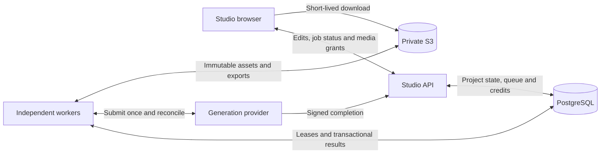

# Studio architecture and API

Creator Studio turns an editable campaign script into approved scene media and a reproducible video. PostgreSQL owns the project, queue, and wallet. Workers execute jobs and publish immutable objects. The browser keeps its current cut while a generation runs.

Local Compose substitutes a deterministic HTTP provider and a private filesystem. Production enables Replicate, HTTPS browser sessions, and S3. The fixture caps are deliberately short. Workers read the recorded provider and inputs of each job.

## Records and transaction boundaries

| Record | Contents and constraint |
| --- | --- |
| Workspace | Wallet, held credits, and active job limit. A scoped key grants editor or viewer access to one workspace. |
| Project | Tenant, creative brief, current script revision, and timeline version. |
| Script revision | Immutable text, parent, and source. A provider result updates the project pointer only if its parent is still current. |
| Scene | Source revision, stable position and trim, current candidate, latest job, and separately accepted asset. |
| Asset | Private object key, media type, duration, and unique producing job. |
| Job | Immutable action inputs, client idempotency key, attempt and lease state, deadline, and result. Export input is the frozen timeline. |
| Credit reservation and ledger | One hold per paid job, one terminal capture or release. The ledger records balance and held deltas. |
| Provider delivery | Unique provider and event ID, destination job, and arrival time. |

The job POST locks the project and checks the idempotency key. It inserts the job, locks its workspace wallet, verifies its active limit, and holds the quoted credits in one transaction. It returns `202 Accepted` and a status URL after commit. Replaying the key returns the existing job for an identical request. Reusing it for a different action returns `409`. Credit holds reserve availability. Capture converts the existing hold to a posted charge. The credit audit compares wallet totals, ledger deltas, and outstanding holds.

Workers claim due jobs with `FOR UPDATE SKIP LOCKED` and commit the lease before making a network call. A heartbeat extends leases for long work, and a replacement worker can reclaim an expired lease. The terminal transaction locks project, scene, and job in that order. It checks the lease token, deadline, and current generation before publishing a candidate. It posts the charge, asset record, and status together. Workers stage object bytes before publishing the database reference. An old result cannot replace an accepted scene or charge again.

## Provider recovery

Demo media requests use the Studio job ID as a stable provider key. With live Replicate, Studio records one durable submission intent before making the prediction POST. If the provider acknowledges the submission, Studio saves its prediction ID and polls it. If that response is lost, a verified callback can bind the ID using a per-job URL. A late callback to an expired job records the ID for reconciliation and leaves the terminal result and credits intact.

Retry wakes the existing job. When a live submission has an unknown outcome, it waits for its signed callback and keeps the hold until a deadline or definitive failure. A crash immediately after recording intent can end a job without a provider run. This behavior avoids resubmitting an ambiguous paid request. External provider costs can differ from the workspace's credit ledger.

An accepted image remains part of the cut while a video is pending. The recovered video is a candidate until the editor approves it. A confirmed **Regenerate** creates a different job and credit hold. Its candidate can be auditioned while the accepted asset remains exportable.

Production callbacks validate the raw body, provider HMAC, timestamp, delivery ID, and a grant bound to the target job. Polling can recover a missed callback after the prediction ID is known. Only HTTPS result URLs on Replicate's delivery domain are fetched. Images are decoded and flattened and videos are normalized to H.264 before becoming assets. Sources and output files are bounded by size, duration, and render limits. [Replicate prediction API](https://replicate.com/docs/topics/predictions/create-a-prediction/), [Webhook verification](https://replicate.com/docs/topics/webhooks/verify-webhook/), [S3 conditional writes](https://docs.aws.amazon.com/AmazonS3/latest/userguide/conditional-writes.html)

## HTTP API

Use `Authorization: Bearer <workspace-access-key>` for API clients. Browser sign-in exchanges the key for an HttpOnly session and restricts cookie-authenticated writes to the configured origin. An editor can create and change projects. A viewer can read projects, job status, and media. Cross-workspace resource lookups return `404`.

| Method and path | Use |
| --- | --- |
| `GET /api/session` | Current workspace, role, and demo capabilities. |
| `POST /api/session` | Exchange an access key for a browser session. |
| `DELETE /api/session` | Revoke the browser session. |
| `GET /api/projects?limit=30&before={projectId}` | Page through workspace projects and read the wallet and prices. |
| `POST /api/projects` | Create a project from a title and a brief. |
| `GET /api/projects/{id}` | Read current project, recent revisions and jobs, approved media and candidates. |
| `POST /api/projects/{id}/script-assist` | Draft or revise against a parent revision. Requires a matching quote and idempotency key. |
| `POST /api/projects/{id}/revisions` | Save an editor revision against the current parent. |
| `POST /api/projects/{id}/scenes` | Split the current script into two to six named scenes. |
| `PUT /api/projects/{id}/timeline` | Replace order and timing using the observed timeline version. |
| `POST /api/scenes/{id}/generations` | Queue Generate or Regenerate with a quote and idempotency key. |
| `POST /api/scenes/{scene}/generations/{job}/retry` | Wake reconciliation for a confirming media job. |
| `PUT /api/scenes/{id}/accepted/{asset}` | Approve the current candidate. |
| `POST /api/projects/{id}/exports` | Queue a render from the observed timeline version and accepted assets. |
| `GET /api/jobs/{id}` | Read state, credit settlement, event history, media, and the export manifest. |
| `GET /api/assets/{id}/content?download=true` | Authorize workspace access and serve media or redirect to a short-lived private S3 URL. |

Queued actions take a UUID in `Idempotency-Key`. Poll `Location` using `Retry-After` as a starting interval and back off during sustained waits. An editor should refresh on `409` timeline conflicts and confirm changed quotes before resubmitting. A browser reuses pending action keys across reloads in the same tab until it knows the outcome.

Export normalizes every accepted scene to 540×960 at 30 fps, rounds cut boundaries to frames, and concatenates the segments into a silent H.264 MP4. Every output carries a manifest with its asset IDs, original trim offsets, target durations, layout, and timeline version. Changes to the project create a different manifest for the next render.
